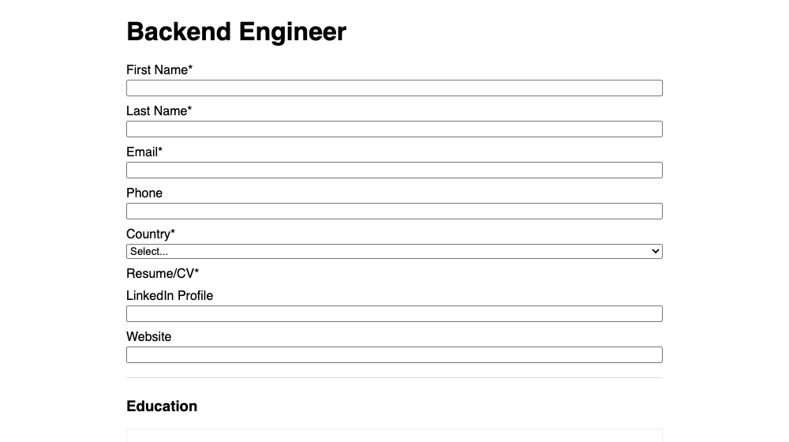
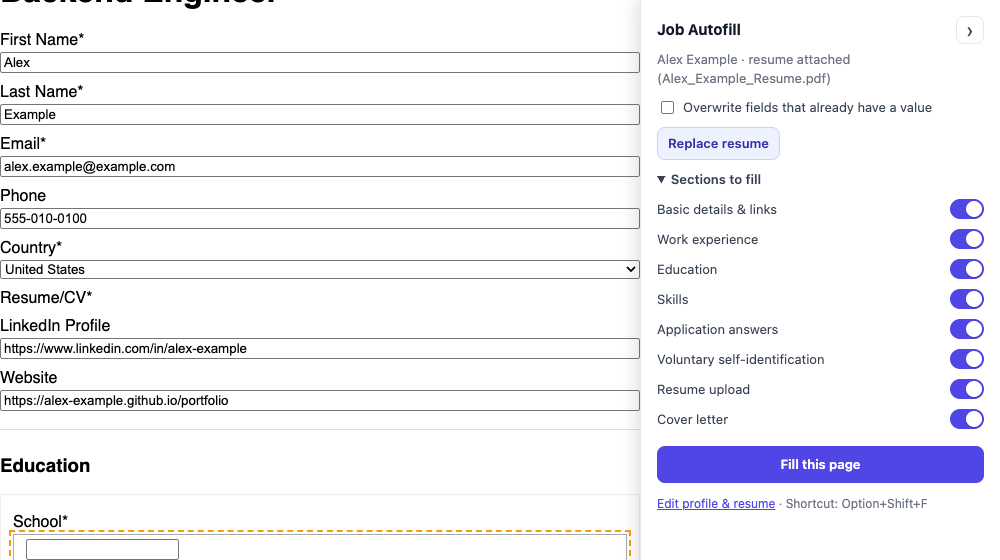
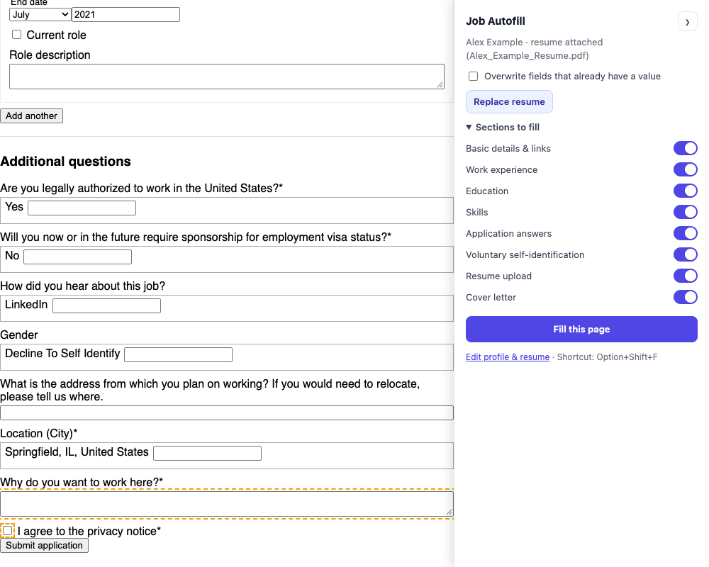
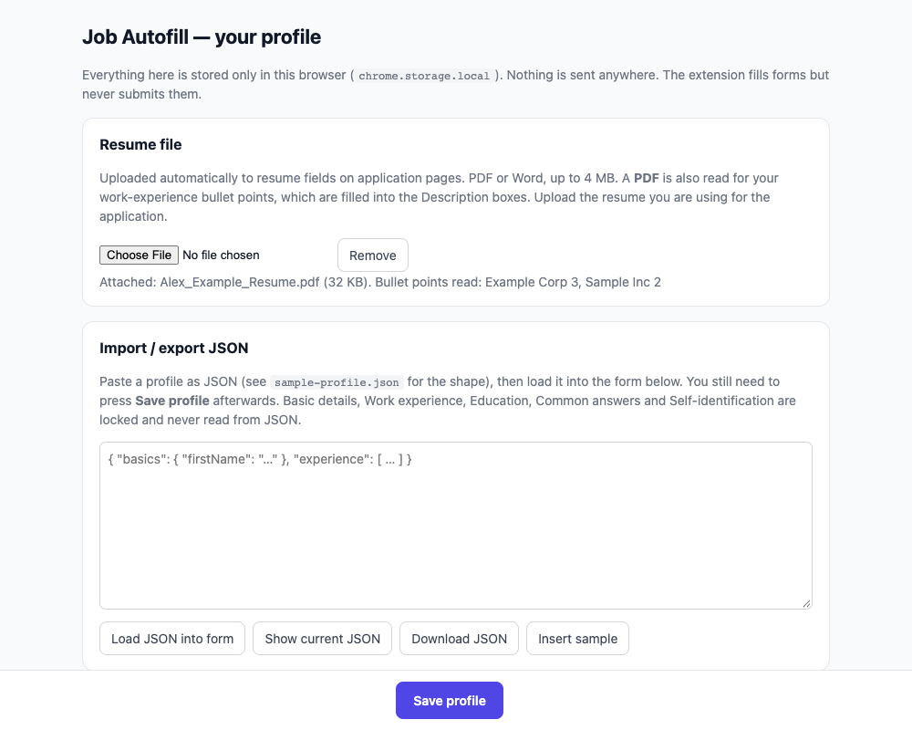

# Job Autofill (Chrome extension)

Fills job applications (basic details, work experience, education, work-authorization answers,
resume upload) from a profile you build once. It **never submits** an application.

## Screenshots

Taken on the mock application page in `tests/pages/` with placeholder data.

**Before and after pressing *Fill this page***

| Before | After |
| --- | --- |
|  |  |

**Dropdowns, radios and answers filled; required fields it can't answer are outlined in orange, and the consent box is left for you**



**The settings page (resume upload and locked sections)**



## Install

1. Open `chrome://extensions` in Chrome.
2. Turn on **Developer mode** (top right).
3. Click **Load unpacked** and pick this `job-autofill` folder.
4. Pin the extension (puzzle-piece icon) so the toolbar button is easy to reach.

## Personal data setup (after cloning)

Your details live in four gitignored files under `src/`. Copy each template and edit it:

```bash
cd src && for f in basics answers education experience; do cp $f.example.js $f.js; done
```

Then edit `basics.js`, `answers.js`, `education.js` and `experience.js` with your own details.
The extension will not load without them. They are listed in `.gitignore` so they are never committed.

## Set up your profile (one time)

Open the extension's **Options** page (right-click the toolbar icon, then *Options*, or use the
"Edit profile & resume" link in the popup).

1. **Resume file**: choose your PDF. It is attached automatically to resume upload fields.
2. **Profile**: either fill in the form, or paste JSON into the import box and press
   *Load JSON into form* (see `sample-profile.json` for the exact shape).
3. Press **Save profile**.

Everything stays in this browser (`chrome.storage.local`). Nothing is sent anywhere.

## Use it

Open an application page, then any of:

- click the floating **Autofill application** button that appears on the page,
- click the toolbar icon, then **Fill this page**,
- press **Option+Shift+F** (change it at `chrome://extensions/shortcuts`). **Option+Shift+P** shows or hides the side panel with the section switches.

Afterwards, fields it could not answer but that the form requires are **outlined in orange**.
Review the whole form before you submit.

## Safety rules (built in)

- Never clicks Submit / Apply / Next.
- Never ticks agreement, consent or privacy checkboxes. Those are outlined for you to tick.
- Only fills answers you have put in your profile. Anything it has no data for is left alone.
- Free-text questions ("Why do you want to work here?") are left empty and flagged.
- Fields that already have a value are kept, unless you tick *Overwrite* in the popup.
- Voluntary self-identification (gender, race, veteran, disability...) is filled only if you
  provide an answer. Leave those blank in your profile to skip them.

## What it handles

| Area | Notes |
| --- | --- |
| Basic details | Names, email, phone, address, links, current company/title |
| Work experience / education | Repeated blocks. It clicks **Add another** to create enough blocks, then fills each one |
| Common answers + self-identification (locked) | Come only from `src/answers.js` (blank = skipped); read-only on the settings page and ignored in imported JSON |
| Work experience (locked) | The jobs (title, company, location, dates) come only from `src/experience.js`. The **Description / bullet points** are read from the PDF resume you upload in the settings page (bundled pdf.js, nothing leaves your browser): the bullets under each company's heading are filled into that job's description box. Upload the resume you are using for the application; a Word resume is attached but not read |
| Basic details (locked) | Come only from `src/basics.js`; read-only on the settings page and ignored in imported JSON. Links: pages with their own LinkedIn / GitHub boxes get those; a list of generic URL boxes (Workday Websites, with an **Add** button) gets portfolio, GitHub and LinkedIn, one per box |
| Education (locked) | Comes only from `src/education.js`; the settings page shows it read-only and ignores any education in imported JSON. Degree and Field of study have an ordered list of names (saved name first, then fallbacks such as `Master's/Advanced Degree`, `Computer and Information Science`); the first one the page really offers is chosen, never a near miss. If none is offered the box is left empty and the popup lists what the page offered |
| Dates | Month/year splits, `MM/YYYY`, `YYYY-MM`, native month and date inputs; current job leaves the end date empty |
| Dropdowns | Native selects, react-select style comboboxes, typeahead/autocomplete. Matches synonyms (`CA` / `California`, `Master of Science` / `Master's Degree`, `Decline to self-identify`) |
| Radios and Yes/No questions | Work authorization, sponsorship, relocation, 18+ |
| Resume | Attached to the resume file input, then waits for sites that parse it (Lever) |
| Embedded forms | Works inside iframes (e.g. Greenhouse embedded on a company site) |
| Workday skills | The Skills box on the My Experience page: types each skill, presses Enter, ticks the exact match in the results. Skips skills already selected and reports the ones the company's list does not offer. It takes about a minute for a long list |
| Sites | Generic matcher for any site, plus tuned adapters for **Greenhouse**, **Lever** and **Workday** (Workday so far only checked against a mock of its skills picker, not a live account) |

Not yet: the rest of Workday's multi-page flow beyond the generic fields, Ashby, iCIMS,
SmartRecruiters, and answering free-text questions with an LLM.

## Project layout

```
manifest.json            Manifest V3
background.js            fans a "fill" request out to every frame of the tab
popup.*                  toolbar popup (Fill button, results)
options.*                profile editor, JSON import/export, resume upload
sample-profile.json      example profile with placeholder data (no education: that is locked)
src/basics.js            the locked basic details
src/experience.js        the locked jobs (bullets come from the uploaded resume)
src/resume-parse.js      finds each job's bullets in a resume's text
vendor/                  pdf.js (Apache-2.0) used by the settings page to read the PDF
src/answers.js           the locked application answers and self-identification
src/education.js         the locked education entries and their Degree / Field of study name lists
src/text.js              normalising, option matching (states, degrees, yes/no), dates
src/util.js              DOM helpers (React-safe value setting, clicks, file attach)
src/matcher.js           works out what each field is asking for (rules + section detection)
src/filler.js            writes values, handles dropdowns/radios/repeated blocks, flags leftovers
src/adapters/*.js        site-specific tuning (generic, greenhouse, lever, workday)
src/content.js           message handling, application-form detection, floating button
tests/                   unit tests, end-to-end test, test pages, classification debug tool
```

## Tests

```bash
node --test tests/text.test.js            # unit tests (no dependencies)
node tests/e2e.js                         # loads the extension in Chromium (needs Playwright)
node tests/classify-page.js <url|file>    # shows how every field on a page is classified
```

`classify-page.js` is the main tool for tuning: when a real site fills something wrong, run it
on that page and look at the `key`, `section` and `label` columns to see which rule fired.

## Adding a site adapter

Create `src/adapters/<site>.js`, call `JA.registerAdapter({ name, match(loc, doc), ... })` and
add the file to `content_scripts.js` in `manifest.json` (before `content.js`). See
`src/adapters/lever.js` for the smallest useful example. An adapter can also define
`skipControl(control, ctx)` (fields it fills itself) and `fillExtras(ctx)` (extra filling after the
ordinary fields); `src/adapters/workday.js` uses both.
